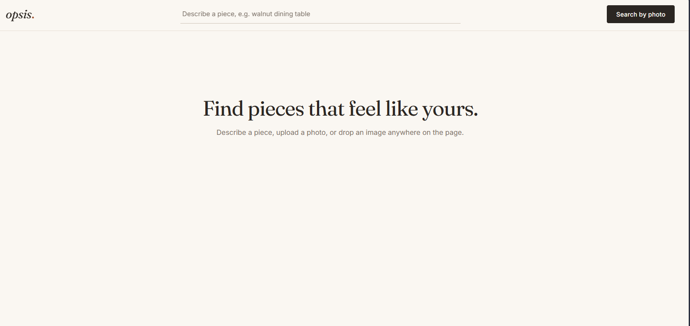

# Opsis

**Opsis (Greek for "sight") finds furniture by how it looks.** Upload a photo or describe a piece, and it returns visually similar items.



<!-- Live demo: add your Hugging Face link here after deploying -->

## How it works

```
photo or text → CLIP → 512-number vector → FAISS similarity search → top 20 similar images
```

1. **Embed:** CLIP (ViT-B/32) turns every image into a vector of 512 numbers. Similar-looking images get similar vectors. CLIP was trained on images paired with captions, so text searches land in the same space as photos.
2. **Index:** All vectors go into a FAISS index. Vectors are normalized, so comparing them measures cosine similarity.
3. **Search:** A query (an uploaded photo, text, or an existing item) is turned into a vector and compared against the index.
4. **Display:** Results appear in a React grid. Click any result to see more like it.

## Results

| Metric | Value |
|---|---|
| Index size | 5,138 images |
| Precision@10 (same category) | 94.6% |
| Index lookup p50 / p95 | 0.73 ms / 1.45 ms |
| Photo search, end to end | 110 ms (down from 2.8 s) |

Precision@10 is the share of the top 10 "more like this" results that are the same type of furniture as the query, averaged over 500 random queries.

**Weakest categories:** tables (87.0%) and chairs (89.9%). <!-- Add what you found when you looked at the wrong results -->

**Speeding up photo search:** Photo search first took 2.8 s because full-size uploads were decoded before CLIP shrinks them to 224×224 anyway. Decoding JPEGs at reduced size and warming up the model at startup cut it to 110 ms.

**Why exact search:** At 5,000 images, checking every vector takes under 2 ms, so the index uses exact search (`IndexFlatIP`). At millions of images I'd switch to an approximate index like HNSW and measure how much precision drops.

## Run it locally

**1. Get the data.** Download `data.zip` from the [Bonn Furniture Styles subset on Figshare](https://figshare.com/articles/dataset/archive/28831787) and copy the folders inside `train` into `data/images`, so images sit at `data/images/<category>/*.jpg`. Any folder of images works; folder names become labels.

**2. Backend**
```bash
python -m venv .venv
.venv\Scripts\activate            # Mac/Linux: source .venv/bin/activate
pip install -r requirements.txt

python -m scripts.build_index      # add --limit 2000 for a quick first run
python -m scripts.evaluate --label category
uvicorn backend.app:app --reload
```

**3. Frontend**
```bash
cd frontend
npm install
npm run dev                        # open http://localhost:5173
```

## API

| Endpoint | Description |
|---|---|
| `GET /search/text?q=walnut+table&k=20` | Search by text |
| `POST /search/image` (form field `file`) | Search by uploaded photo |
| `GET /similar/{id}` | "More like this" for an indexed item |
| `GET /health` | Status and number of indexed images |

## Tests

```bash
pip install -r requirements-dev.txt
pytest -q
```
The tests use a small stand-in for CLIP, so they run in under a second without downloading the model. They cover indexing (including skipping broken files), search, evaluation, and every API endpoint. GitHub Actions runs them on every push.

## Next steps

- Crop the main object out of a room photo before searching, to fix table/chair mix-ups
- Show "no close matches" when the top score is low, instead of weak results
- Filter results by furniture type
